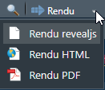
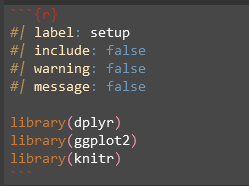

```{r}
#| label: setup
#| include: false
#| warning: false
#| message: false

library(dplyr)
library(ggplot2)
library(knitr)
```

## Pré-requis techniques

- Quarto (≥ 1.5)
- RStudio (≥ 2022.07) et R (≥ 4)

- => Installé par défaut sur Cerise !


# Introduction

Un module des [formations à R dispensées au SSM Agriculture](https://ssm-agriculture.github.io/site-formations-R/)


## Objectifs

-   Intérêt des publications reproductibles
-   Découvrir la versatilité de Quarto
-   Réaliser un document, de simple à complexe

::: notes
versatile : pour le langage en entrée et les formats en sortie (diapo suivante)
:::

## Quarto

### Un système de publication

{#fig-works}


- qmd : fichier quarto 
- knitr : package R pour générer des fichiers markdown  
- md : fichier markdown  
- pandoc : convertisseur universel de documents  
- sorties multi-formats (html, word, pdf...)

::: notes
- Mélange code et texte : une partie du document est générée par des données (tableaux, graphiques ou texte)
- Successeur de Rmarkdown
- Commandes complémentaires LaTeX ou Typst pour le PDF
- Pandoc est un convertisseur "universel" de formats de texte
:::


### Formats/moteurs

:::::: columns
::: {.column width="50%"}
-   [multi-format](https://quarto.org/docs/gallery/)
    -   HTML (rapports, livres, présentations)
    -   PDF
    -   Appli web (statique/interactif) : blog, site, tableau de bord
    -   Powerpoint
    -   MS Word
:::

::: {.column width="50%"}
-   multi-langage
    -   R
    -   Python
    -   [Observable](https://observablehq.com/)
    -   [Julia](https://julialang.org/)
:::
::::::

::: notes
Le format PDF nécessite {tinytex}
:::


## Avantages

- intégration avec R
- reproductibilité
  - session vierge à chaque génération
  - limiter les copier/coller entre outils
  - prise en compte des changements de données ou de méthodes
- interactivité possible dans le document (HTML)
- versionnement avec Git et compatible avec le CI/CD (intégration continue)

::: notes
- afficher du code dans le doc
- éviter les copier/coller : synchronisation analyse/résultats
- faciliter la reproductibilité avec {renv}
:::

## Inconvénients

-   syntaxe (markdown)
-   génération active du rendu pour visualiser
-   débogage parfois plus complexe

::: notes
- Mais disponibilité d'un éditeur visuel [What You See Is What You Mean](https://en.wikipedia.org/wiki/WYSIWYM) dans RStudio.
- Asynchrone
:::

## Derniers détails sur l'installation

Un paquet {quarto} et un binaire `quarto` (ils sont pré-installés sur CERISE).

Vérification dans le terminal :

```{.bash}
quarto check install
quarto check knitr
```

::: callout-note
### Si nécesaire
``` r
install.packages("quarto")
```

Le format PDF nécessite LaTeX.

```{.bash}
quarto install tinytex
```
:::

::: notes
- Le programme est livré avec RStudio (mais peut être installé à part aussi)
- La paquet n'est pas indispensable mais peut être utile
- Typst n'est pas encore disponible sur CERISE (sauf en pré-prod) pour générer du PDF sans LaTeX
:::

# Structure et syntaxe

## Premiers pas avec quarto

- Comment créer votre premier document quarto ?
- Un mode "source" et un mode "visuel"
- Générer un document ["self contained"](https://quarto.org/docs/output-formats/html-basics.html#self-contained)  

## Premier exemple

::: notes
On passe en revue rapidement les éléments d'un document Quarto, puis on revient sur chaque élément en détail par la suite
:::

----

````{.markdown}
---
title: "Litany against fear"
author: "Bene Gesserit"
---

I must not fear. *Fear is the mind-killer*. Fear is the little-death that
brings total obliteration. 

```{{python}}
import numpy as np
np.exp(np.pi * complex(0, 1)) + 1
```

**I will face my fear.** I will permit it to pass over me and through me.

```{{r}}
somme <- sum(1:10)
```
````

::: notes
Un exemple pour montrer rapidement les différents éléments qu'on décrira ci-après
:::

## markdown

Un langage balisé simplifié

[doc](https://quarto.org/docs/authoring/markdown-basics.html)

::: notes
Inventé en 2004 pour offrir une syntaxe facile à lire et à écrire, en l'état, sans formatage. 
:::

## chunks

Le code exécutable est intégré dans un *chunk* (bloc) :

```{{r}}
#| label: mon-chunk
#| warning: false

1+1
```

<kbd>Ctrl</kbd> <kbd>Alt</kbd> <kbd>i</kbd>

[doc](https://quarto.org/docs/computations/r.html)

::: notes
- détails dans la partie Code
- Triple quote + le langage dans des accolades
- Les commentaires/pipe permettent de préciser des options (la plus grosse différence visible entre Rmarkdown et Quarto)
- `label:` est un identifiant (facultatif mais conseillé)
:::

## En-tête de configuration

- En language [YAML](https://fr.wikipedia.org/wiki/YAML)
- bloc entre `---`
- Facultatif mais *a minima* : `title:`, `author:`, `date:`, `format:`
- Options nombreuses et variables selon les formats => voir [ici](https://quarto.org/docs/output-formats/html-basics.html)

## Rendu

Avec la console R :
```{.r}
quarto_render("mon_document.qmd")
```

Avec le terminal :
```{.bash}
quarto render mon_document.qmd
```

<kbd>Ctrl</kbd> <kbd>⇧</kbd> <kbd>k</kbd> ou {width="75pt" style="vertical-align:text-top"} (ou
{width="131pt" style="vertical-align:text-top"})

::: notes
Le tricotage/rendu se fait dans une nouvelle session à chaque fois et n'impacte pas votre environnement courant ; de même les objets de votre environnement courant ne sont pas disponibles, par défaut, lors du rendu
:::

---

::: callout-note
### À vous de jouer

[Exercice 1.](exercices/exercices_corriges_quarto.html#interface) : découvrir l'interface
:::

## Éléments

### Texte

- 2 retours à la ligne pour faire un paragraphe
- 2 espaces et 1 retour à la ligne pour un saut de ligne
- `*` ou `_` pour mettre en *\*italique\** ou en **\*\*gras\*\***
- `[un lien](https://www.example.org/)` → [un lien](https://www.example.org/)
- une portion de texte peut être stylée en [vert]{style="color:darkgreen"} avec `[vert]{style="color:darkgreen"}`
- mais du HTML est aussi possible `<span style="color:red">rouge</span>` pour mettre en <span style="color:red">rouge</span>

[doc](https://quarto.org/docs/authoring/markdown-basics.html)

### Titres

Préfixer le titre avec `#`, `##` ou `###` pour avoir les titres de niveau 1, 2 ou 3, *etc.*.

`#### Titre de niveau 4`

#### Titre de niveau 4

### Listes

::::: columns
::: {.column width="50%"}
``` markdown
- Atréides
  - Leto
  - Jessica
  - Paul
- Harkonnen
  - Vladimir
  - Rabban
  - Feyd-Rautha
```

ou

``` markdown
- Atréides
  * Leto
  * Jessica
  * Paul
- Harkonnen
  + Vladimir
  + Rabban
  + Feyd-Rautha
```
:::

::: {.nonincremental .column width="50%"}
- Atréides
  * Leto
  * Jessica
  * Paul
- Harkonnen
  + Vladimir
  + Rabban
  + Feyd-Rautha
:::
:::::

----

::::: columns
::: {.column width="50%"}
``` markdown
1. Atréides
   - Leto
   - Jessica\
     **2 espaces (ou `\`) + nouvelle ligne + aligner
     pour ajouter du texte dans les items**
   - Paul
2. Harkonnen
   - Vladimir
   - Rabban
   - Feyd-Rautha
```
:::

::: {.nonincremental .column width="50%"}
1. Atréides
   - Leto
   - Jessica\
     **2 espaces (ou `\`) + nouvelle ligne + aligner pour ajouter du texte dans les items**
   - Paul
2. Harkonnen
   - Vladimir
   - Rabban
   - Feyd-Rautha
:::
:::::

::: notes
Renumérotation automatique incrémentée à partir du premier numéro trouvé.
:::

### [Images](https://quarto.org/docs/authoring/figures.html)

``

{#fig-dune fig-alt="A sand worm on Arrakis"}

``` markdown
{#fig-dune fig-alt="A sand worm on Arrakis"}
```

::: notes
Utiliser le préfixe `fig-` pour l'identifiant afin de pouvoir bénéficier des renvois automatiques et de la numérotation automatique
:::


### Renvois

(*cross-references*)

Un lien automatique est créé si on indique `@fig-dune` : Quarto nous écrit le lien (type et numéro) qui renvoie à @fig-dune.

Les noms des types affichés peuvent être modifiés dans l'en-tête :

``` yaml
---
crossref:
  fig-prefix: figure # par défaut : Figure
  fig-title:  Figure
  tbl-prefix: tableau # par défaut : Tableau
  tbl-title:  Tableau
  title-delim: " &ndash; "
---
```

### Notes de pied de page

Les notes se construisent en ajoutant un `[^1]` dans le texte, avec le `1` pouvant être une numérotation (pas obligatoirement dans l'ordre) ou tout autre mot clé. La note est ensuite introduite avec le même symbole dans un nouveau paragraphe :

`[^1]: texte de la note`

C'est normalement facile[^1] à faire si on se rappelle de la syntaxe.

[^1]: [page d'aide](https://quarto.org/docs/authoring/markdown-basics.html#footnotes) sur les notes de bas de page.


### Équations

Syntaxe LaTeX entre des `$` (inline) ou `$$` (bloc).

``` tex
$\sigma = \sqrt{\frac{1}{N} \sum_{i=1}^N (x_i - \mu)^2},\text{ où } \mu = \frac{1}{N} \sum_{i=1}^N x_i$
```

$$\sigma = \sqrt{\frac{1}{N} \sum_{i=1}^N (x_i - \mu)^2},\text{ où } \mu = \frac{1}{N} \sum_{i=1}^N x_i$$ [doc](https://quarto.org/docs/authoring/markdown-basics.html#equations)


### Libellés

(*Callout*)

Les "libellés" permettent de mettre en exergue des informations complémentaires.

``` markdown
:::{.callout-note}
Il existe cinq types de libellés : 
`note`, `tip`, `warning`, `caution` et `important`.
:::
```

::: callout-note
Il existe cinq types de libellés : `note`, `tip`, `warning`, `caution` et `important`.
:::

----

``` markdown
::: callout-warning
Suite aux nombreux manquements à l’obligation de contrôle hebdomadaire (...)
:::
```

::: callout-warning
Suite aux nombreux manquements à l'obligation de contrôle hebdomadaire de l'étanchéité (...)
:::

``` markdown
::: {.callout-tip title="Mon titre"}
This is a callout with a title.
:::
```

::: {.callout-tip title="Mon titre"}
This is a callout with a title.
:::


[doc](https://quarto.org/docs/authoring/callouts.html)

---

::: callout-note
### À vous de jouer

[Exercice 2.](exercices/exercices_corriges_quarto.html#doc-simple) produire un document simple
:::

### Thèmes

Quarto est fourni avec plusieurs thèmes => voir [ici](https://quarto.org/docs/output-formats/html-themes.html).

### Code

Un bloc de code (ou chunk en anglais) exécuté sans options.  

```{r}
#| label: exemple-code

glm(Sepal.Length ~ Sepal.Width, data = iris)

```


----

#### Options de bloc de code

De [nombreuses options](https://quarto.org/docs/computations/execution-options.html) sont disponibles pour personnaliser les blocs de code.  


-   Exécution : 
  - `#| eval:` exécuter le code
  - `#| echo:` afficher le code
-   Nommage : 
  - `#| label:` identifiant du chunk (pas obligatoire mais si vous décidez d'en mettre, pas de doublons)
  - `#| fig-cap:` sert uniquement à légender une figure (image ou graphique par exemple)

  
### Outils

Si on a `#| echo: true` l'utilisateur voit le code

On peut aussi ajouter des outils pour l'utilisateur pour qu'il affiche ou cache les chunks avec, dans l'en-tête YAML :

``` yaml
format: 
  html:
    code-fold: true
    code-tools: true
```

- `code-fold: true` permet à l’utilisateur de plier / déplier le code sous les résultats.  

- `code-tools: true` permet d'ajouter une barre d’outils en haut du quarto pour les blocs de code.


### Le bloc de code `setup`

**Pour charger les packages et gérer la configuration de votre quarto**, il est recommandé d'inclure un premier bloc de code juste après l'en-tête de votre document.  
Voici un exemple : 

{#fig-setup}

---

::: callout-note
#### À vous de jouer

[Exercice 3.](exercices/exercices_corriges_quarto.html#code) Code
:::


### Tableaux

Les tableaux sont balisés ainsi en Markdown :

:::::: columns
::: {.column width="50%"}

````{.markdown}
| année | titre                   |
|------:|:------------------------|
|  1965 | Dune                    |
|  1969 | Le Messie de Dune       |
|  1976 | Les Enfants de Dune     |
|  1981 | L'Empereur-Dieu de Dune |
|  1984 | Les Hérétiques de Dune  |
|  1985 | La Maison des mères     |

: Cycle de Dune {#tbl-cycle}
````

:::
::: {.column width="50%"}

| année | titre                   |
|------:|:------------------------|
|  1965 | Dune                    |
|  1969 | Le Messie de Dune       |
|  1976 | Les Enfants de Dune     |
|  1981 | L'Empereur-Dieu de Dune |
|  1984 | Les Hérétiques de Dune  |
|  1985 | La Maison des mères     |

: Cycle de Dune {#tbl-cycle}

:::
::::::

[doc](https://quarto.org/docs/authoring/tables.html)  

Voir [cet outil en ligne](https://www.tablesgenerator.com/markdown_tables).

----

Mais la plupart du temps on affichera des tableaux programmatiquement.

```{r}
#| label: tbl-iris-tibble
#| tbl-cap: "Iris (tibble)"
#| output-location: column

iris |> 
  summarise(.by = Species,
            moy_sepales = sum(Sepal.Length))
```

----

Avec {knitr} ou le paramètre en en-tête :

``` yaml
format:
  html:
    df-print: kable
```

```{r}
#| label: tbl-iris-kable
#| tbl-cap: "Iris (kable)"
#| output-location: column

iris |> 
  summarise(.by = Species,
            moy_sepales = sum(Sepal.Length)) |> 
  knitr::kable()
```

[doc](https://quarto.org/docs/computations/r.html#data-frames)

::: notes
Contrôler l'impression de data.frame avec `df-print: kable` ou `df-print: paged`, `df-print: tibble`
Interactivité javascript `df-print: paged` à voir en exercice
:::

----

ou avec {gt}

```{r}
#| label: tbl-iris-gt
#| tbl-cap: "Iris (gt)"
#| output-location: column
library(gt)

iris |> 
  summarise(.by = Species,
            moy_sepales = sum(Sepal.Length)) |> 
  gt()
```


::: notes
Utiliser le préfixe `tbl-` pour l'identifiant afin de pouvoir bénéficier des renvois automatiques et la numérotation automatique
:::

---

::: callout-note
#### À vous de jouer

[Exercice 4.](exercices/exercices_corriges_quarto.html#tableaux) Tableaux
:::


### Graphiques

```{r}
#| label: fig-iris
#| fig-cap: "Iris"
#| output-location: column
#| fig-alt: Graphique en nuage de points des longueurs et largeurs de pétales par espèce d'Iris
#| out-width: "100%"
#| fig-width: 7
#| fig-height: 5.5
ggplot(iris, aes(Petal.Length, 
                 Petal.Width, 
                 color = Species)) +
  geom_point()
```

Taille d'image dans Quarto [@arel-bundockConsistentFiguresQuarto2024]

::: notes
Interactivité possible avec {plotly} ou {ggiraph}. *cf.* exercices
:::

---

::: callout-note
#### À vous de jouer

[Exercice 5.](exercices/exercices_corriges_quarto.html#graphiques) Graphiques
:::

### Cartes

```{r}
#| label: fig-carte2
#| fig-cap: "Exemple Leaflet"
#| out-width: 100%
#| output-location: column
#| eval: !expr knitr::is_html_output() 

library(leaflet)
library(sf)

"donnees/adminexpress_cog_simpl_000_2024.gpkg" |> 
  read_sf(layer = "region") |> 
  leaflet() |> 
  addTiles() |> 
  addPolygons()
```

::: {.content-visible when-format="pdf"}
Carte interactive non-visualisable au format PDF.
:::

---

::: callout-note
#### À vous de jouer

[Exercice 6.](exercices/exercices_corriges_quarto.html#cartes) Cartes
:::

### Présentations

On peut faire [des présentations](https://quarto.org/docs/presentations/).  

- Chaque nouvelle slide est définie avec un titre de niveau 2 (`##`).  
- Pour rédiger une slide sur plusieurs colonnes c'est [ici](https://quarto.org/docs/presentations/#multiple-columns).  
- L'emplacement des outputs des blocs de code [peut être configuré](https://quarto.org/docs/presentations/revealjs/#output-location).


### Diagrammes

- [Mermaid](https://mermaid.js.org/)
- À construire avec [mermaid.live](https://mermaid.live)

----

::: {.content-visible when-format="html"}
```{mermaid}
%%| output-location: column

flowchart TD
    A[(données)] --> B(importer) 
    B --> C[/données valides/]
    C --> D{"sum(sau > 200)"}
    D -- oui --> E(OK)
    D -- non --> F(Stop)
```
:::

::: {.content-visible when-format="pdf"}
Graphe non-visualisable au format PDF.
:::


## Fonctionnalités avancées

### Rapports paramétrés

````{.markdown filename="mon_document.qmd"}
---
title: Rapport
format:
  html: default
params:
  region: 84
  sortie: knitr
---

## Région `{{r}} params$region`

```{{r}}
sau <- ra |> 
  filter(siege_reg == params$region) |> 
  summarise(.by = siege_dep,
            sau_tot = sum(sau_tot, na.rm = TRUE))

if (params$sortie == "knitr") kable::knitr(sau) else sau
```
````

----

On n'est pas obligé de changer manuellement les paramètres et re-tricoter ; on peut itérer sur une liste :

```{.r}
for (r in c(11, 94, 84, 04)) {
  quarto::quarto_render("mon_document.qmd",
                        execute_params = list(region = r),
                        output_file = paste0("rapport_", r, ".html"))
}
```

résultera en 4 rapports personnalisés : *rapport_11.html*, *rapport_94.html*,...

[doc](https://quarto.org/docs/computations/parameters.html)

---

### Autres exemples de rapports paramétrés

[Exemple 1](https://gist.github.com/ddotta/67d1a54a94eb9648be6f3fe36cfe3e05) qui génère un contenu différent en Html/Pdf ou en fonction du paramètre srise.  

[Exemple 2](https://quarto-dev.github.io/quarto-r/articles/dynamic-metadata.html#advanced-use-case-conditional-content-based-on-parameters) issu de la documentation officielle.  

### Inclusions

En tout point du qmd :

```{.markdown}
{}
```

[doc](https://quarto.org/docs/authoring/includes.html)

ou dans le YAML pour ajouter de simples en-tête et pieds de page :

````{.markdown}
---
format:
  html:
    include-before-body: en_tete.html
    include-after-body: pied.html
---
````

[doc](https://quarto.org/docs/output-formats/html-basics.html#includes)

### Cache

Pour les calculs longs et rarement variables on peut gagner du temps avec `cache: true` (au niveau document ou chunk).

```{{r}}
#| label: long-traitement
#| cache: true
#| cache-extra : !expr file.mtime("donnees/departements.gpkg")

region <- read_sf("donnees/departements.gpkg") |> 
  st_union()
```

Ne sera exécuté qu'une fois sauf si le code du *chunk* change ou si la date du fichier change ou si on passe à `cache: false`, ou via :

```{.bash}
quarto render mon_document.qmd --cache-refresh
```

[doc](https://quarto.org/docs/computations/caching.html)

::: notes
`cache` peut être défini au niveau projet, document ou chunk.
:::

# Marque de l'État

## Typographie Marianne

Pour textes et graphiques [@servicedinformationdugouvernementCharteGraphiqueLEtat2020]

-   Installer {ragg}, {systemfonts} et {textshaping}

-   Dans l'en-tête yaml du document Quarto :

    ``` yaml
    ---
    mainfont: Marianne
    knitr:
      opts_chunk: 
        dev: "ragg_png"
    ---
    ```

::: notes
Permet d'avoir la police Marianne pour le texte et de la prendre en compte dans les graphiques ggplot.

Autre possibilité (à mettre dans un *chunk* de configuration en début de document) : `knitr::opts_chunk$set(dev = "ragg_png")`
:::

# Références

----

::: {#refs}
:::
